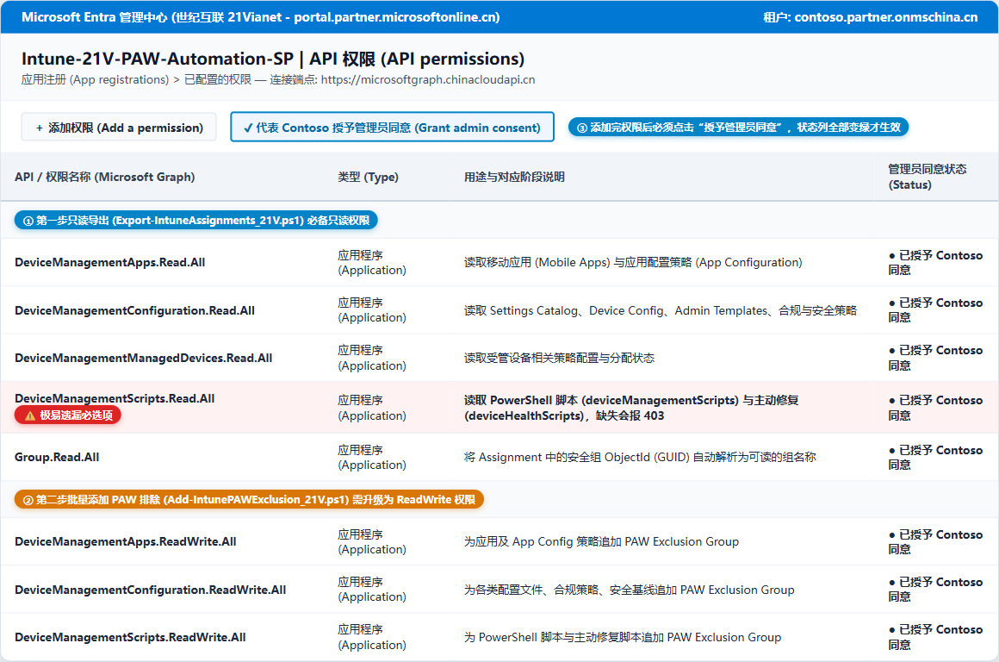
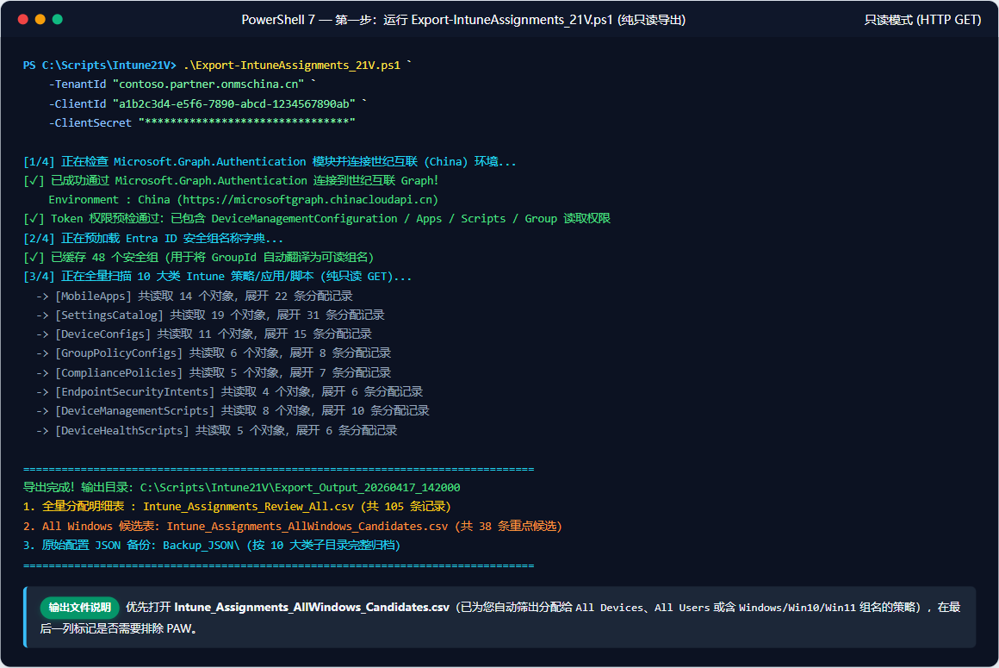
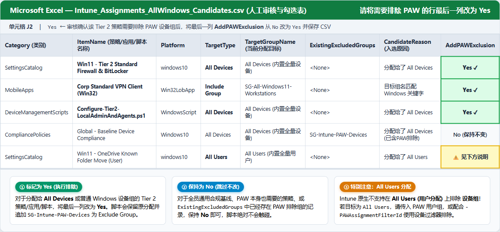
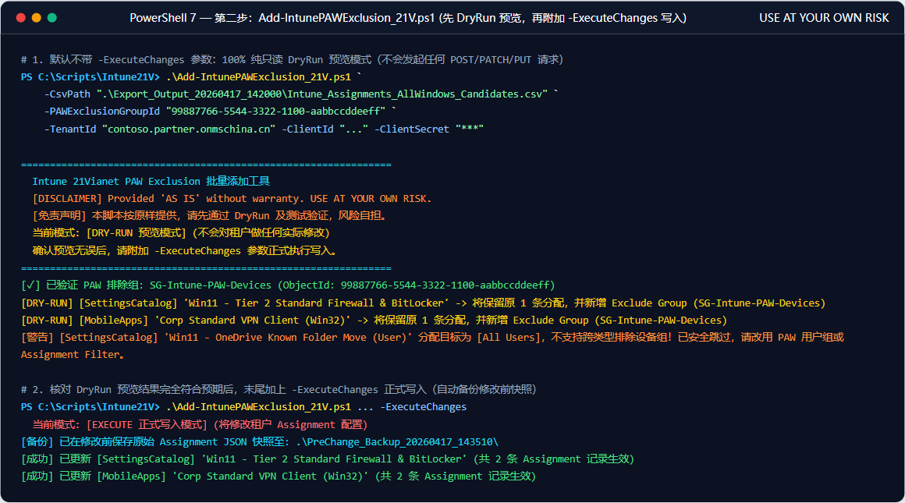
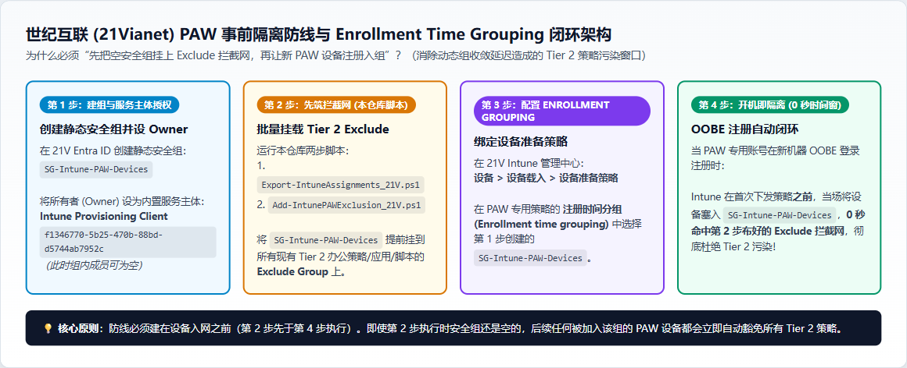

# 世纪互联 (21Vianet) Intune 全量导出与 PAW 排除脚本使用指南

> ### ⚠️ DISCLAIMER / 免责声明 (USE AT YOUR OWN RISK)
> **English:** This sample script is not supported under any Microsoft standard support program or service. The sample script is provided **AS IS** without warranty of any kind. Microsoft further disclaims all implied warranties including, without limitation, any implied warranties of merchantability or of fitness for a particular purpose. The entire risk arising out of the use or performance of the sample scripts and documentation remains with you.
>
> **中文：** 本仓库中的示例脚本按“原样 (AS IS)”提供，不提供任何明示或暗示的担保。对于第一步只读导出脚本 (`Export-IntuneAssignments_21V.ps1`)，它仅发送 HTTP GET 请求读取配置；对于第二步批量变更脚本 (`Add-IntunePAWExclusion_21V.ps1`)，**使用该脚本修改租户配置的一切风险由使用者自行承担 (USE AT YOUR OWN RISK)**。在附加 `-ExecuteChanges` 参数对生产环境执行实际写入前，请务必：
> 1. 人工逐行审核导出的 CSV 文件中标记为 `AddPAWExclusion = Yes` 的对象；
> 2. 先在默认的 **DryRun（只读预览）** 模式下运行并核对控制台输出；
> 3. 先在测试环境或少量非核心策略上验证，并妥善保管脚本自动生成的 `PreChange_Backup_<时间戳>` JSON 快照。

本仓库包含三套针对 **世纪互联 (Azure China / 21Vianet)** 环境的 Intune PowerShell 自动化脚本（全量只读导出 + 批量追加 PAW 排除 + 一键应急回滚），用于解决原生示例脚本仅支持全球版 (`graph.microsoft.com`)、仅能导出单一策略类别且缺乏回滚保障的问题。

---

## 一、脚本清单与作用

| 脚本文件名 | 模式 | 作用说明 |
| :--- | :--- | :--- |
| **`Export-IntuneAssignments_21V.ps1`** | **纯只读 (GET)** | 导出 Intune 中全部 **10 大类**对象（App、App Config、Settings Catalog、Device Config、Admin Templates、Compliance、Endpoint Security、PowerShell Script、Proactive Remediation）的配置 JSON 备份及所有 Assignment 分配明细；自动识别哪些是给 **All Windows** 的，生成 Excel 审核表。 |
| **`Add-IntunePAWExclusion_21V.ps1`** | **写入 (POST)** | 读取人工审核后的 CSV 表（将 `AddPAWExclusion` 标为 `Yes` 的行），在保留原有所有分配的前提下，批量追加 **PAW Exclusion Group**（或挂载 PAW Exclusion Filter）。默认开启 **DryRun 预览模式**，并在修改前自动将原始分配保存至 `PreChange_Backup_<时间戳>`。 |
| **`Restore-IntuneAssignments_21V.ps1`** | **回滚 (POST)** | **应急回滚脚本**：读取 `PreChange_Backup_<时间戳>`（或全量导出的 `Backup_JSON`），将指定对象或整批对象的 Intune Assignment **100% 还原**到修改前的原始快照状态（精准剥离后加的 PAW Exclusion）。默认开启 **DryRun 预览模式**，支持按单策略 ID (`-FilterItemId`) 或类别 (`-FilterCategory`) 精准回滚。 |

---

## 二、权限与认证方式说明（支持 Service Principal 与 `-UseInteractive` 交互式登录）

本套脚本支持 **两种认证模式** 连接世纪互联 Microsoft Graph (`https://microsoftgraph.chinacloudapi.cn`)。企业可根据自身安全合规要求灵活选择（**推荐组合：第一步只读导出使用模式 A，第二步/第三步写入修改使用模式 B `-UseInteractive`**）：

| 对比维度 | 模式 A：Service Principal 密钥模式（默认） | 模式 B：`-UseInteractive` 交互式委托登录（推荐用于写入阶段） |
| :--- | :--- | :--- |
| **适用场景** | 自动化无人值守运行、只读全量导出 (`Export-IntuneAssignments_21V.ps1`) | 生产环境执行写入变更 (`Add-IntunePAWExclusion_21V.ps1`) 或回滚 (`Restore-IntuneAssignments_21V.ps1`)，安全团队不希望给 Client Secret 授予常驻高危 `ReadWrite` 应用权限 |
| **API 权限类型** | **Application（应用程序权限）** | **Delegated（委托权限）** |
| **凭证要求** | `TenantId` + `ClientId` + `ClientSecret` | `TenantId` + `ClientId` + **`-UseInteractive`**（无需 `ClientSecret`，由管理员本人交互式登录并完成 MFA） |
| **安全优势** | 无需人工交互，适合定时/批量读取 | **最小权限原则 (Least Privilege)**：有效权限取 `App 委托权限 ∩ 登录管理员自身的 RBAC 角色`，即使 `ClientId` 泄露也无法脱离管理员本人登录去修改租户 |

---

### 1. 只读导出阶段 (`Export-IntuneAssignments_21V.ps1`) —— 推荐使用 Application 权限
在 **Entra ID (`portal.partner.microsoftonline.cn`) -> 应用注册 -> API 权限** 中添加以下 **Application (应用程序)** 权限，并点击 **代表租户授予管理员同意 (Grant admin consent)**：
- `DeviceManagementApps.Read.All`（读取应用、App Config）
- `DeviceManagementConfiguration.Read.All`（读取 Settings Catalog、Device Config、Admin Templates、Compliance、Endpoint Security）
- `DeviceManagementManagedDevices.Read.All`（读取受管设备相关策略）
- **`DeviceManagementScripts.Read.All`**（⚠️ **必选**：用于读取 `deviceManagementScripts` PowerShell 脚本与 `deviceHealthScripts` Proactive Remediations，缺少此权限这两类会返回 403 Forbidden）
- `Group.Read.All`（或 `Directory.Read.All`，用于把 Assignment 里的 Group GUID 翻译为可读的组名称）

---

### 2. 批量添加排除与回滚阶段 (`Add-IntunePAWExclusion_21V.ps1` / `Restore-IntuneAssignments_21V.ps1`)

#### 方案 B1（推荐）：使用 `-UseInteractive` 交互式登录 + Delegated（委托）权限
若安全合规要求不给应用密钥授予 `Application` 级别的 `ReadWrite` 权限，请按以下三步配置并使用 `-UseInteractive`：
1. **配置 API 委托权限 (Delegated Permissions)**：在 App Registration 的 **API permissions -> Add a permission -> Microsoft Graph -> Delegated permissions（委托的权限）** 中按需添加以下权限，并点击 **Grant admin consent**：
   - `DeviceManagementApps.ReadWrite.All`（修改应用与 App Config 分配时必选）
   - `DeviceManagementConfiguration.ReadWrite.All`（修改配置策略、合规策略、Endpoint Security 分配时必选）
   - `DeviceManagementManagedDevices.ReadWrite.All`（修改受管设备相关策略时必选）
   - `DeviceManagementScripts.ReadWrite.All`（可选：仅当需要修改 PowerShell 脚本或 Proactive Remediations 分配时添加）
   - `Group.Read.All`（可选：仅用于校验组对象信息）
2. **开启公共客户端流 (Public Client Flows)**：在 App Registration 左侧菜单进入 **Authentication（身份验证）**：
   - 将页面底部的 **Allow public client flows（允许公共客户端流）** 设为 **Yes（是）**；
   - 点击 **Add a platform -> Mobile and desktop applications（移动和桌面应用程序）**，勾选或填入重定向 URI **`http://localhost`** 并保存。
3. **登录账号角色要求**：执行脚本时交互式登录的管理员账号需具备 **Intune Administrator（Intune 管理员）**（或 Global Administrator）角色。

#### 方案 B2：继续使用 Service Principal (`-ClientSecret`) + Application（应用程序）权限
若使用无人值守的密钥模式执行写入，则上述 `ReadWrite.All` 权限必须添加为 **Application（应用程序权限）** 并点击 **Grant admin consent**（注意：若仅配置了 `Delegated` 权限却使用 `-ClientSecret` 登录，调用写入接口会报错 `403 Forbidden`）。

> 💡 **自动检测与安装 `Microsoft.Graph.Authentication`**：三份脚本在启动时会自动检查本机是否安装了 `Microsoft.Graph.Authentication` 模块；若未安装会自动以 `CurrentUser` 范围静默安装，随后调用 `Connect-MgGraph -Environment China` 与 `Invoke-MgGraphRequest`，并在连接后自动校验当前会话或复用已登录的委托会话。



---

## 三、分步操作流程（附可视化截图说明）

### 第一步：执行全量只读导出 (`Export-IntuneAssignments_21V.ps1`)
在 PowerShell 中运行以下命令（纯只读 `GET` 操作，绝对不会修改任何租户配置）：

```powershell
cd "C:\Scripts\Intune21V"

.\Export-IntuneAssignments_21V.ps1 `
    -TenantId "<您的21V租户ID或域名，如 contoso.partner.onmschina.cn>" `
    -ClientId "<App Registration 的 Client ID>" `
    -ClientSecret "<Client Secret>"
```

脚本运行结束后，会在当前目录下生成 `Export_Output_<时间戳>` 文件夹，内含：
1. **`Intune_Assignments_AllWindows_Candidates.csv`**：自动筛选出的疑似分配给 **All Windows**（包括 Windows 策略分配给 `All Devices`、`All Users`，或分配给名字含 `Windows`/`Win10`/`Win11` 的组）的重点审核表。
2. **`Intune_Assignments_Review_All.csv`**：租户内所有对象的全量分配表。
3. **`Intune_Objects_Summary.csv`**：每个策略/应用/脚本的汇总状态表（每个对象一行，便于全局盘点哪些对象尚未配置 PAW 排除）。
4. **`Backup_JSON\`**：按类别保存的每个策略/应用/脚本的完整配置与当前 Assignment JSON 备份。



---

### 第二步：在 Excel 中人工审核 CSV 并标记 `AddPAWExclusion = Yes`
1. 用 Excel 打开 `Intune_Assignments_AllWindows_Candidates.csv`（或 `Intune_Assignments_Review_All.csv`）。
2. 查看 `Category`、`ItemName`、`TargetType`、`TargetGroupName` 以及 `ExistingExcludedGroups`（是否已经排除过 PAW）。
3. 对于确定需要添加 PAW 排除的 Tier 2 策略/应用/脚本，将最后一列 **`AddPAWExclusion`** 的值从 `No` 改为 **`Yes`**，保存 CSV。

> ⚠️ **特别注意（Intune 平台核心限制）**：
> - 如果某条策略/应用的分配目标是 **`All Devices`** 或 **Device Group（设备组）**，直接添加 **PAW 设备组** 作为 Exclusion Group 完全生效。
> - 如果某条策略/应用的分配目标是 **`All Users`** 或 **User Group（用户组）**，Intune **不支持跨类型排除设备组**（排除不会生效）。针对 `All Users` 分配，要么排除 **PAW 用户组**，要么使用 **Assignment Filter (`-PAWAssignmentFilterId`)** 进行设备属性排除。



---

### 第三步：批量添加 PAW Exclusion（先 DryRun 预览，再正式执行）

脚本同时支持 **`-UseInteractive`（交互式委托权限登录，推荐）** 和 **Service Principal（`-ClientSecret` 应用密钥登录）** 两种方式：

#### 方式 A（推荐）：使用 `-UseInteractive` 交互式管理员登录（基于 Delegated 委托权限）
```powershell
# 1. 先跑 DryRun 预览（默认不加 -ExecuteChanges，100% 只读预览，不会修改任何配置）
.\Add-IntunePAWExclusion_21V.ps1 `
    -CsvPath ".\Export_Output_xxxx\Intune_Assignments_AllWindows_Candidates.csv" `
    -PAWExclusionGroupId "<PAW设备组的Object_ID_GUID>" `
    -TenantId "<21V_TenantId>" `
    -ClientId "<ClientId>" `
    -UseInteractive

# 2. 确认预览输出无误后，加上 -ExecuteChanges 正式执行写入
.\Add-IntunePAWExclusion_21V.ps1 `
    -CsvPath ".\Export_Output_xxxx\Intune_Assignments_AllWindows_Candidates.csv" `
    -PAWExclusionGroupId "<PAW设备组的Object_ID_GUID>" `
    -TenantId "<21V_TenantId>" `
    -ClientId "<ClientId>" `
    -UseInteractive `
    -ExecuteChanges
```

#### 方式 B：使用 Service Principal (`-ClientSecret`) 登录（基于 Application 应用权限）
```powershell
# 1. 先跑 DryRun 预览（默认不加 -ExecuteChanges，100% 只读预览）
.\Add-IntunePAWExclusion_21V.ps1 `
    -CsvPath ".\Export_Output_xxxx\Intune_Assignments_AllWindows_Candidates.csv" `
    -PAWExclusionGroupId "<PAW设备组的Object_ID_GUID>" `
    -TenantId "<21V_TenantId>" `
    -ClientId "<ClientId>" `
    -ClientSecret "<ClientSecret>"

# 2. 确认预览输出无误后，加上 -ExecuteChanges 正式执行写入
.\Add-IntunePAWExclusion_21V.ps1 `
    -CsvPath ".\Export_Output_xxxx\Intune_Assignments_AllWindows_Candidates.csv" `
    -PAWExclusionGroupId "<PAW设备组的Object_ID_GUID>" `
    -TenantId "<21V_TenantId>" `
    -ClientId "<ClientId>" `
    -ClientSecret "<ClientSecret>" `
    -ExecuteChanges
```

正式执行前，脚本会自动在 `PreChange_Backup_<时间戳>` 目录下保存每个待修改对象的修改前 JSON 快照。



---

### 💡 常见认证报错与 `-UseDeviceCode`（设备代码登录）排错指南

在企业内网环境中使用 `-UseInteractive` 进行交互式登录时，可按下面的方法分别处理登录窗口失败和管理员同意提示。**`-UseDeviceCode` 是 `Connect-MgGraph` 的参数，不是本套脚本的参数**：先在同一个 PowerShell 窗口登录，再让脚本复用已建立的 `China` + `Delegated` 会话。设备代码登录不会绕过管理员同意、MFA 或条件访问；租户策略也可能限制设备代码流。

#### 报错 1：`The browser based authentication dialog failed to complete. Reason: The requested resource requires user authentication.`
- **触发时机**：运行带 `-UseInteractive` 的脚本时，PowerShell 5.1 / ISE 弹出内置迷你登录窗口，输入账号后立刻闪退并报上述错误。
- **可能原因**：浏览器登录链路中的身份验证、联合登录或代理认证未完成。仅凭这段错误不能确认是 ADFS、WIA 还是代理导致；需要进一步结合登录日志和网络错误判断。
- **可尝试的替代方式（使用 `-UseDeviceCode` 在独立浏览器中完成认证）**：
  1. 在同一个 PowerShell 窗口中，先手动执行以下命令发起 **设备代码登录 (Device Code Flow)**。这一步只断开旧 Graph 会话并建立新会话，不修改租户配置；`-Scopes` 应按本次实际操作及已获同意的 Delegated 权限选择：
     ```powershell
     Disconnect-MgGraph -ErrorAction SilentlyContinue

     Connect-MgGraph -Environment China `
         -TenantId "<21V_TenantId>" `
         -ClientId "<ClientId>" `
         -Scopes "DeviceManagementApps.ReadWrite.All", "DeviceManagementConfiguration.ReadWrite.All", "DeviceManagementManagedDevices.ReadWrite.All" `
         -UseDeviceCode
     ```
  2. 控制台会输出验证网址和 **设备代码 (Device Code)**，请使用本次命令实际显示的网址与代码。
  3. 在日常浏览器（Edge / Chrome）打开该验证网址，输入设备代码并使用目标租户的 **Intune 管理员账号** 完成登录及适用的 MFA。等待 PowerShell 命令成功返回，并用 `Get-MgContext` 核对 `Environment` 为 `China`、`AuthType` 为 `Delegated`，以及 `TenantId`、`ClientId` 和 `Scopes` 符合本次操作。
  4. **保持在同一个 PowerShell 窗口**，先运行脚本预览（带上 `-UseInteractive`，不加 `-ExecuteChanges`，不修改租户配置）：
     ```powershell
     .\Add-IntunePAWExclusion_21V.ps1 `
         -CsvPath ".\Export_Output_xxxx\Intune_Assignments_AllWindows_Candidates.csv" `
         -PAWExclusionGroupId "<PAW设备组的Object_ID_GUID>" `
         -TenantId "<21V_TenantId>" `
         -ClientId "<ClientId>" `
         -UseInteractive
     ```
     脚本检测到可复用的会话时，会打印 **`[Auth] 已复用现有 21V Graph 交互式会话`**，无需再次打开交互式登录窗口。核对 DryRun 结果后，如需正式写入，再按第三步的说明添加 `-ExecuteChanges`。

#### 报错 2：浏览器登录时弹出 `Need admin approval`（需要管理员批准）
- **触发时机**：使用 `-UseInteractive` 或 `-UseDeviceCode` 登录输入密码后，浏览器卡在 **"Need admin approval (<应用名> needs permission to access resources in your organization that only an admin can grant)"**。
- **本次排查发现**：请求的 `Group.Read.All` 与 `DeviceManagementScripts.ReadWrite.All` 触发了管理员同意提示；移除这两个 scope 后，客户通过设备代码成功登录并执行了所需的 PAW 排除操作。
- **检查方向**：请求的 Delegated 权限是否已获得所需的管理员同意，以及租户的用户同意策略是否允许本次请求。已授予的 **Application 权限不等于 Delegated 权限已获同意**；切换到设备代码流不会改变这一点。
- **解决方案**：
  - 对本次任务**不需要**的可选权限，可从 `Connect-MgGraph -Scopes` 中移除，按上方示例仅请求本次操作需要且已获同意的权限。
  - 对本次任务**确实需要**的权限，应由有权授予同意的管理员添加相应 **Delegated** 权限并完成 **Grant admin consent**，而不是单纯删除 scope。
  - **登录成功不代表所有类别都可读写**：上方三个 scope 的示例不包含 `Group.Read.All` 或 `DeviceManagementScripts.ReadWrite.All`。若后续接口返回 `403 Forbidden`，应按该接口在 21V 支持的权限要求排查；不能据此认定这些权限对所有场景都不需要。

---

## 四、进阶架构：配合 21V Enrollment Time Grouping 实现 PAW 零时间窗事前隔离

在世纪互联 (21Vianet) 环境中，若依赖传统的 Entra ID 动态安全组等待设备入网后再收敛进组，往往存在 **数分钟到数十分钟的动态组评估延迟**，导致新注册的 Tier 0 (PAW) 设备在刚入网时被 `All Devices` 的 Tier 2 普通办公软件/脚本污染。

推荐将本仓库脚本与 **Windows Autopilot 设备准备工作 (Device Preparation / Enrollment Time Grouping)** 结合，按以下 **四步先后顺序** 构建零时间窗防线：

1. **第 1 步（建组与授权）**：在 21V Entra ID 中创建静态安全组（如 `SG-Intune-PAW-Devices`），并将内置服务主体 **`Intune Provisioning Client`**（App ID: `f1346770-5b25-470b-88bd-d5744ab7952c`）添加为该组的 **所有者 (Owner)**。此时组内可以没有任何设备成员（空组）。
2. **第 2 步（先筑拦截网 — 运行本仓库脚本）**：在新 PAW 设备开机注册**之前**，先运行本仓库的 `Export-IntuneAssignments_21V.ps1` 与 `Add-IntunePAWExclusion_21V.ps1`，将上述静态安全组 `SG-Intune-PAW-Devices` 提前挂到所有现有 Tier 2 策略、应用和脚本的 **Exclude Group** 上。
3. **第 3 步（配置注册时间分组 Enrollment Time Grouping）**：在 21V Intune 管理中心（`intune.partner.microsoftonline.cn`）进入 **设备 > 设备载入 > 设备准备策略**，在 PAW 专用设备准备策略的 **注册时间分组 (Enrollment time grouping)** 中选择 `SG-Intune-PAW-Devices`。
4. **第 4 步（开机即隔离闭环）**：当管理员使用 PAW 专用账号在新机器 OOBE 界面登录注册时，Intune 会在下发任何策略**之前**，当场将该设备塞入 `SG-Intune-PAW-Devices`，**0 秒命中第 2 步提前布好的 Exclude 拦截网**，彻底杜绝 Tier 2 策略污染。



---

## 五、应急回滚方案 (Rollback Plan — `Restore-IntuneAssignments_21V.ps1`)

在执行第三步 (`Add-IntunePAWExclusion_21V.ps1 -ExecuteChanges`) 时，脚本在调用 Graph `/assign` 接口修改任何策略/应用/脚本之前，都会先强制在本地生成 **`PreChange_Backup_<时间戳>`** 文件夹，并将每个对象修改前的原始 Assignment 完整保存为 `<Category>_<ItemId>_Before.json`（此外，第一步导出时生成的 `Export_Output_<时间戳>\Backup_JSON` 也包含全租户基线备份）。

如果变更后发现某条策略不希望排除 PAW，或者需要整批撤回变更，可使用 **`Restore-IntuneAssignments_21V.ps1`** 实现秒级无损回滚。

### 场景 1：先执行回滚 DryRun 预览（默认只读对比，不修改线上配置）
默认不加 `-ExecuteRollback` 时，脚本会读取本地备份快照，并与 21V 线上当前生效的 Assignment 进行实时对比，展示回滚前后差异（同样支持 `-UseInteractive` 交互式登录或 `-ClientSecret` 密钥登录）：

```powershell
# 使用 -UseInteractive 交互式登录（若已通过 Connect-MgGraph -UseDeviceCode 登录，会自动直接复用）
.\Restore-IntuneAssignments_21V.ps1 `
    -BackupFolderPath ".\PreChange_Backup_20260416_153000" `
    -TenantId "<21V_TenantId>" `
    -ClientId "<ClientId>" `
    -UseInteractive
```
> 💡 若使用 Service Principal 密钥登录，将 `-UseInteractive` 替换为 `-ClientSecret "<ClientSecret>"` 即可；若在无外网或离线机器上仅需核对本地备份内容及即将构造的 `/assign` 恢复报文，可附加 `-OfflineDryRun` 参数。

### 场景 2：仅对某一个特定策略/应用执行精准单点回滚 (`-FilterItemId`)
如果只需要回滚某一条特定策略或单个应用（例如发现某款安全软件在 PAW 上仍需安装），可指定 `-FilterItemId`（和可选的 `-FilterCategory`）并附加 `-ExecuteRollback`：

```powershell
.\Restore-IntuneAssignments_21V.ps1 `
    -BackupFolderPath ".\PreChange_Backup_20260416_153000" `
    -FilterItemId "<策略或应用的_ItemId_GUID>" `
    -TenantId "<21V_TenantId>" `
    -ClientId "<ClientId>" `
    -UseInteractive `
    -ExecuteRollback
```

### 场景 3：整批一键回滚（还原当次批量修改的所有对象）
确认 DryRun 预览无误后，附加 `-ExecuteRollback` 即可将 `PreChange_Backup_<时间戳>` 中的所有对象一键还原为变更前的原始分配状态（精准剥离新增的 PAW Exclusion，同时完整保留原有的 Win32 应用安装参数、Delivery Optimization 设置、Filter 及所有原有分配组）：

```powershell
.\Restore-IntuneAssignments_21V.ps1 `
    -BackupFolderPath ".\PreChange_Backup_20260416_153000" `
    -TenantId "<21V_TenantId>" `
    -ClientId "<ClientId>" `
    -UseInteractive `
    -ExecuteRollback
```

> 📋 **回滚审计日志**：每次运行 `Restore-IntuneAssignments_21V.ps1`（无论是 DryRun 还是正式回滚），脚本都会在备份目录同级自动生成 **`Rollback_AuditLog_<时间戳>.csv`**，完整记录每个对象的回滚前线上分配数、回滚后分配数、接口地址及执行状态，满足合规变更审计要求。

